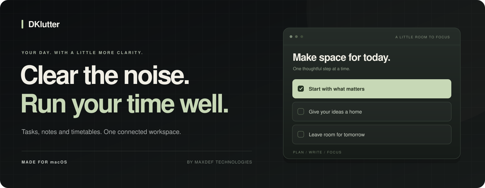

 

**A calmer home for your tasks, notes and time.**

Plan a busy week, capture an idea, or make space for your next big thing. 
DKlutter brings your day together in one focused workspace on your Mac.

**macOS 13.0 or later · Apple Silicon · Version 1.1.1**

[What’s new](CHANGELOG.md) &nbsp; · &nbsp; [Download details](https://github.com/maxdeftech/DKlutter-desktop/releases/latest) &nbsp; · &nbsp; [Get help](SUPPORT.md)

---

## Less scattered. More connected.

Your plans shouldn’t have to live in five different places. DKlutter connects the things you need to do, the ideas you want to keep, and the time you have to work with.

<table>
<tr>
<td width="50%" valign="top">

### ◇ Plan with purpose

Organize tasks, events and reminders. Move between daily, weekly, monthly and yearly views without losing the bigger picture.

</td>
<td width="50%" valign="top">

### ✎ Keep your ideas close

Write and organize notes beside the work they belong to. Capture a quick thought or give a longer idea room to grow.

</td>
</tr>
<tr>
<td width="50%" valign="top">

### ▦ Give your week a rhythm

Build colour-coded timetables and move projects through Kanban boards that fit the way you work.

</td>
<td width="50%" valign="top">

### ◐ Make it feel like yours

Choose light or dark mode and personalize your colours. Keep your familiar DKlutter workspace close at hand on your Mac.

</td>
</tr>
</table>

## Your workspace. Now on your Mac.

- **One account, familiar plans.** Sign in with your existing DKlutter account to access your workspace across the web and desktop.
- **Google sign-in in your browser.** Authenticate in your usual browser, then return to the app to get started.
- **Reminders where you need them.** Turn on Mac notifications for workspace alerts and choose what you want to hear about.
- **Useful desktop touches.** Print, save to PDF and keep DKlutter ready in your Dock. You can also choose to open it when you log in to your Mac.

An internet connection and a DKlutter account are required. Feature availability depends on your plan and workspace permissions.

## Up and running in a moment

**1. Download** the [current Mac installer](https://github.com/maxdeftech/DKlutter-desktop/releases/latest/download/DKlutter-macOS-Apple-Silicon.dmg).

**2. Install** by opening the DMG and dragging **DKlutter** into **Applications**.

**3. Make yourself at home.** Open DKlutter and sign in. If you choose Google, finish in your browser and allow it to open DKlutter when asked.

**Updating?** Quit the old app first, then replace it in Applications. Your account and saved workspace remain available when you sign back in.

<strong>A few useful things to know</strong>

- This download is for **Apple Silicon Macs**: M1, M2, M3, M4 and later Apple chips. Check **Apple menu → About This Mac** if you are unsure. An Intel download is not currently provided here.
- To receive alerts, enable notifications in DKlutter and allow them in **System Settings → Notifications → DKlutter**. Focus settings can affect when they appear.
- Alerts can continue when you close the window. Choosing **Quit DKlutter** stops them until you reopen the app.
- If macOS prevents the app from opening, please [contact support](SUPPORT.md) with the message you see. Keep your Mac’s security settings enabled.
- The artwork above illustrates the idea of a calmer day; it is not an app screenshot.

## What’s new

### 1.1.1 · November 18, 2026

- Google sign-in now opens in your usual browser and brings you back to DKlutter after you sign in.
- Improved sign-in for a fresh installation on another Mac.

[Read the full changelog →](CHANGELOG.md)

## Always the current download

This repository is the download home for **DKlutter for macOS**. It contains the current release, a getting-started guide and a history of user-facing changes. When a new working version is published, it replaces the previous download here.

[See the current release](https://github.com/maxdeftech/DKlutter-desktop/releases/latest) · [Browse all DKlutter product updates](https://dklutter.maxdeftech.com/updates)

---

**Make space for what matters.**

Made by [MaxDef Technologies](https://github.com/maxdeftech) 
[DKlutter](https://dklutter.maxdeftech.com) · [Privacy](https://dklutter.maxdeftech.com/privacy-policy) · [Terms](https://dklutter.maxdeftech.com/terms-of-service) · [Support](mailto:maxwellinnovativetechnologies@gmail.com)

